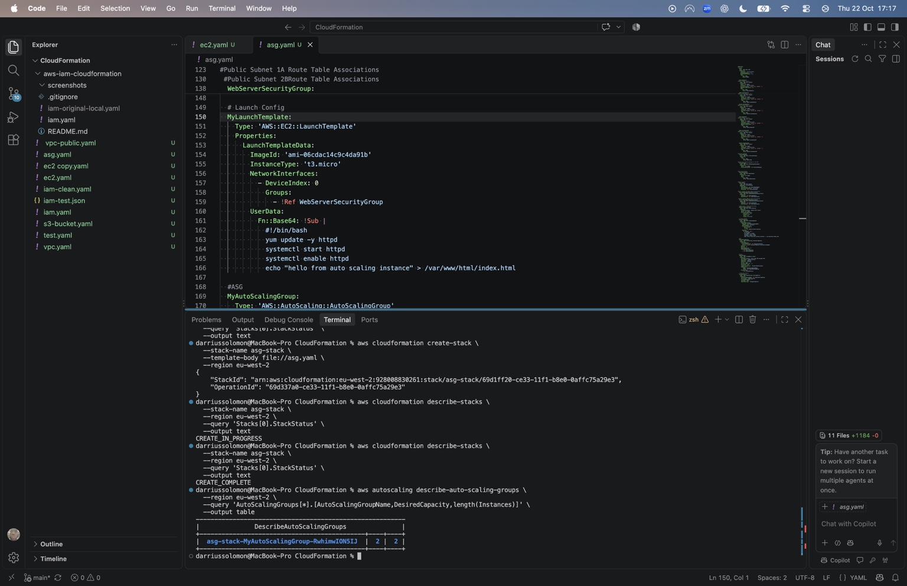
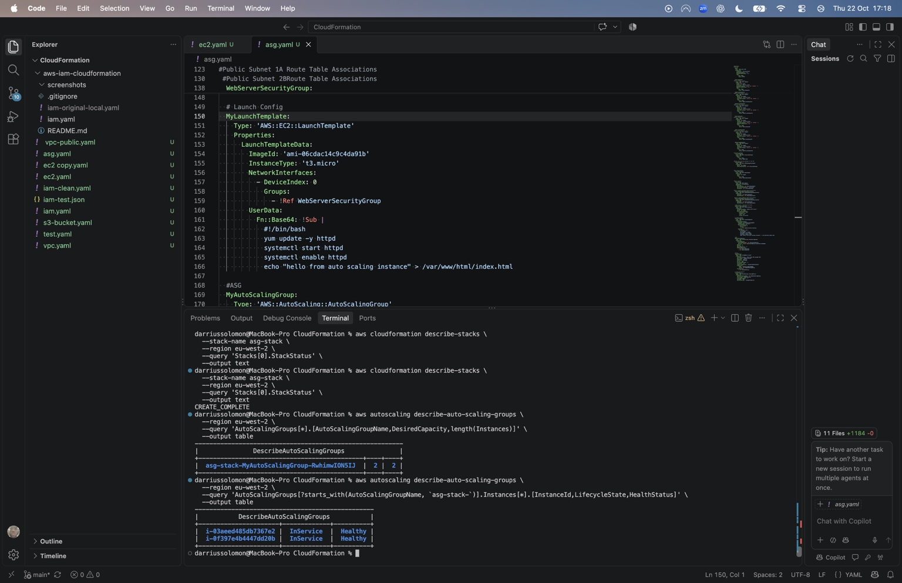
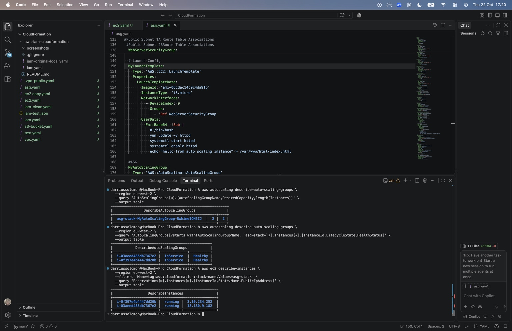

# AWS Auto Scaling Infrastructure Using CloudFormation

## Project Overview

In this project, I deployed a scalable AWS web infrastructure using AWS CloudFormation to automate the provisioning of cloud resources.

The infrastructure includes an Amazon VPC, public and private subnets across two Availability Zones, an Application Load Balancer (ALB), and an EC2 Auto Scaling Group.

The Auto Scaling Group was configured with a desired capacity of two EC2 instances, a minimum of one instance, and a maximum of three instances.

The purpose of this project was to gain practical experience with Infrastructure as Code (IaC), automated EC2 provisioning, load balancing, and building infrastructure designed for scalability and high availability.

I also used the AWS CLI to verify the deployment, confirm that the EC2 instances were healthy, and remove the infrastructure after completing the project to avoid unnecessary AWS charges.

## AWS Services Used

- **AWS CloudFormation:** Used to provision and manage the infrastructure through a YAML template.
- **Amazon VPC:** Provided an isolated network environment for the infrastructure.
- **Amazon EC2:** Hosted the web server instances.
- **EC2 Auto Scaling:** Managed the number of EC2 instances based on the configured capacity.
- **Application Load Balancer (ALB):** Distributed incoming HTTP traffic across the web server instances.
- **EC2 Launch Template:** Defined the configuration used to launch EC2 instances.
- **Security Groups:** Controlled inbound and outbound network traffic.
- **AWS CLI:** Used to deploy, verify, monitor, and delete the infrastructure.

## Infrastructure Configuration

The Auto Scaling Group was configured with:

- **Minimum capacity:** 1 EC2 instance
- **Desired capacity:** 2 EC2 instances
- **Maximum capacity:** 3 EC2 instances
- **Instance type:** t3.micro
- **AWS Region:** eu-west-2 (London)
- **Availability Zones:** eu-west-2a and eu-west-2b

## Architecture Overview

The infrastructure was designed to support a scalable web application across two AWS Availability Zones in the London region (eu-west-2).

An Application Load Balancer (ALB) distributes incoming HTTP traffic across EC2 instances managed by an Auto Scaling Group.

The Auto Scaling Group maintains the configured number of EC2 instances and can adjust capacity within the defined minimum and maximum limits.

## How the Architecture Works

1. A user sends an HTTP request to the Application Load Balancer.
2. The Application Load Balancer routes the request to a healthy EC2 instance in its target group.
3. The EC2 instance processes the request and returns a response.
4. The Auto Scaling Group maintains the desired number of instances and replaces unhealthy instances when required.
5. The infrastructure uses two Availability Zones to improve resilience and reduce dependence on a single location.

## Scalability and High Availability

The Auto Scaling Group was configured with a minimum capacity of one instance, a desired capacity of two instances, and a maximum capacity of three instances.

This configuration provides a foundation for scaling the application as demand changes.

Distributing resources across two Availability Zones also helps improve availability by reducing the impact of an individual Availability Zone failure.

## CloudWatch Monitoring and Automatic Scaling

The CloudFormation template includes an Amazon CloudWatch alarm and an EC2 Auto Scaling scale-out policy.

The CloudWatch alarm was configured with the following settings:

* Metric: CPUUtilization
* Threshold: Greater than 70%
* Evaluation period: 300 seconds (5 minutes)
* Statistic: Average

## The Auto Scaling policy was configured with:

* Scaling type: Simple Scaling
* Scaling adjustment: +1 EC2 instance
* Cooldown period: 300 seconds (5 minutes)
* Maximum Auto Scaling Group capacity: 3 instances

## How Automatic Scaling Works

1. Amazon CloudWatch monitors the configured CPU utilisation metric.
2. If the metric exceeds 70% for the configured evaluation period, the CloudWatch alarm can enter the ALARM state.
3. The alarm triggers the EC2 Auto Scaling scale-out policy.
4. The scaling policy requests an increase of one EC2 instance, subject to the Auto Scaling Group’s maximum capacity.
5. The Auto Scaling Group launches an additional instance using the EC2 Launch Template when increased capacity is required and permitted.

This configuration demonstrates how CloudWatch monitoring and EC2 Auto Scaling policies can work together to support automatic infrastructure scaling.

Note: The scaling configuration was defined in CloudFormation, but a CPU load test was not performed to demonstrate the scaling policy being triggered.

## Deployment Process

I used AWS CloudFormation to provision the infrastructure through Infrastructure as Code (IaC), rather than manually creating each resource in the AWS Management Console.

The infrastructure was defined in a YAML template named asg.yaml, which describes the AWS resources and their configurations.

## 1. Create the CloudFormation Template

I created a YAML template to define the infrastructure resources, including:

* Amazon VPC and networking components
* Public and private subnets across two Availability Zones
* Application Load Balancer and target group
* EC2 Launch Template
* EC2 Auto Scaling Group
* Security Groups

Using CloudFormation allowed me to define the infrastructure in code and deploy the resources as a stack.

## 2. Deploy the Infrastructure

I used the AWS CLI to deploy the CloudFormation template.

CloudFormation processed the YAML template and created the resources defined within it.

This approach helped me practise automated infrastructure provisioning and understand how AWS resources can be managed together.

## 3. Verify the Deployment

After deployment, I used the AWS Management Console and AWS CLI to inspect the infrastructure.

I checked the CloudFormation stack status and reviewed the EC2 instances created by the Auto Scaling Group.

I also inspected the Auto Scaling configuration to confirm the minimum, desired and maximum instance capacities.

## 4. Clean Up AWS Resources

After completing the deployment and verification, I removed the infrastructure to avoid leaving unnecessary AWS resources running and generating additional charges.

This reinforced the importance of managing cloud resources throughout their lifecycle.

Verification and Testing

After deploying the infrastructure using AWS CloudFormation, I used the AWS Management Console and AWS CLI to inspect the resources and verify the deployment.

## 1. CloudFormation Stack Verification

I reviewed the CloudFormation stack to check its deployment status and confirm that the infrastructure resources had been provisioned.

This helped me understand how CloudFormation manages resources as part of a single stack.

## 2. EC2 Auto Scaling Group Verification

I inspected the EC2 Auto Scaling Group to review its capacity configuration:

* Minimum capacity: 1 EC2 instance
* Desired capacity: 2 EC2 instances
* Maximum capacity: 3 EC2 instances

The desired capacity specifies how many instances the Auto Scaling Group attempts to maintain under normal conditions.

## 3. EC2 Instance Verification

I used the AWS CLI to inspect the EC2 instances associated with the deployment.

This allowed me to review their operational status and practise verifying AWS resources from the command line.

## 4. Application Load Balancer Verification

I reviewed the Application Load Balancer configuration and its relationship with the EC2 Auto Scaling Group.

The load balancer was configured to distribute incoming HTTP traffic to registered targets.

## 5. Infrastructure Clean-up

After completing the project, I removed the deployed infrastructure to avoid unnecessary AWS charges.

This provided practical experience with the infrastructure lifecycle, including deployment, verification and resource clean-up.

Deployment Screenshots

The following screenshots show the CloudFormation deployment, Auto Scaling Group configuration and EC2 instance verification.

## 1. CloudFormation Deployment

This screenshot shows the CloudFormation stack deployment and the infrastructure resources created through the YAML template.

## 2. Auto Scaling Group Configuration

This screenshot demonstrates the Auto Scaling Group configuration, including the minimum, desired and maximum instance capacities.

## 3. EC2 Instance Health

This screenshot shows the EC2 instances registered with the Auto Scaling Group and their health status.

Both instances were confirmed as InService and Healthy.

## 4. CloudFormation YAML Configuration

This screenshot highlights the CloudFormation configuration used to define the EC2 Launch Template and Auto Scaling Group.

## Deployment Screenshots

The following screenshots provide evidence of the CloudFormation deployment, EC2 Auto Scaling configuration, and infrastructure verification using the AWS CLI.

### 1. CloudFormation Template and Configuration

The CloudFormation YAML template defines the EC2 Launch Template and Auto Scaling Group.

The Auto Scaling Group was configured with a minimum capacity of one instance, a desired capacity of two instances, and a maximum capacity of three instances.

The terminal output also confirms that the CloudFormation stack reached `CREATE_COMPLETE`.

### 2. CloudFormation Deployment Verification

After deploying the infrastructure, I used the AWS CLI to verify the CloudFormation stack status.

The stack reached `CREATE_COMPLETE`, confirming that the infrastructure was successfully provisioned.

I also queried the Auto Scaling Group and confirmed that its desired capacity was two instances, with two instances present.

### 3. Auto Scaling Instance Health Verification

I used the AWS CLI to inspect the instances managed by the Auto Scaling Group.

The command output confirmed that both EC2 instances were:

- In the `InService` lifecycle state.
- Reporting a `Healthy` health status.

This demonstrated that the Auto Scaling Group had successfully provisioned and registered its two instances.

### 4. EC2 Instance Verification

I used the AWS CLI to retrieve information about the EC2 instances created by the CloudFormation stack.

The command output confirmed that both instances were in the `running` state and displayed their assigned public IP addresses.

This provided additional verification that the EC2 instances had been successfully provisioned.

## Challenges and Troubleshooting

During this project, I encountered several challenges while deploying the infrastructure using AWS CloudFormation.

These challenges provided valuable opportunities to develop my troubleshooting skills and improve my understanding of Infrastructure as Code (IaC).

## 1. CloudFormation Deployment Failures

During the deployment process, the CloudFormation stack failed multiple times due to configuration issues within the YAML template.

I investigated these failures, reviewed the infrastructure configuration, and made adjustments before attempting further deployments.

This helped me understand the importance of troubleshooting infrastructure deployments systematically rather than simply assuming the template would work as expected.

## 2. YAML Syntax and Indentation Issues

One of the challenges I encountered involved YAML indentation and formatting.

Because YAML relies on consistent indentation to define its structure, incorrect spacing can prevent CloudFormation from interpreting a template correctly.

I reviewed and corrected indentation issues within the template to resolve configuration errors.

This reinforced the importance of writing structured, readable, and correctly formatted Infrastructure as Code.

## 3. Adapting Older Training Materials

The project was initially based on training materials created approximately two years earlier.

While following the deployment instructions, I encountered differences between the configurations demonstrated in the training materials and the AWS environment I was using.

To address these differences, I reviewed and modified sections of the CloudFormation YAML template.

This involved adding, removing, and updating configuration elements to support the deployment.

The experience reinforced the importance of understanding the purpose of infrastructure configurations rather than relying exclusively on step-by-step instructions.

## 4. Iterative Troubleshooting and Deployment

Resolving the deployment issues required multiple attempts.

My troubleshooting process involved:

* Reviewing CloudFormation deployment failures.
* Identifying potential YAML syntax and configuration problems.
* Correcting indentation and updating resource definitions.
* Reattempting the CloudFormation deployment.
* Using the AWS CLI to verify the infrastructure after successful deployment.

Through this process, I gained practical experience troubleshooting Infrastructure as Code and validating deployed AWS resources.

## 5. Successful Deployment and Verification

After resolving the configuration issues, the CloudFormation stack successfully reached CREATE_COMPLETE.

I subsequently verified that the EC2 Auto Scaling Group had provisioned two instances.

Both instances were reported as InService and Healthy, and additional AWS CLI checks confirmed that they were running.

This demonstrated the value of persistence, systematic troubleshooting, and verifying infrastructure after deployment.

## Lessons Learned

Completing this project strengthened my understanding of AWS CloudFormation, EC2 Auto Scaling, Infrastructure as Code (IaC), and cloud infrastructure troubleshooting.

The experience also helped me develop practical skills in deploying, configuring, and verifying AWS resources using YAML templates and the AWS CLI.

## 1. Infrastructure as Code (IaC)

I gained practical experience using AWS CloudFormation to define and provision infrastructure through a YAML template.

This helped me understand how infrastructure can be deployed consistently through code rather than manually configuring each resource in the AWS Management Console.

I also learned the importance of correctly defining resource properties, references, and dependencies within CloudFormation templates.

## 2. EC2 Auto Scaling

I developed a better understanding of how EC2 Auto Scaling Groups manage EC2 instances.

Through this project, I configured an Auto Scaling Group with:

* Minimum capacity: 1 instance
* Desired capacity: 2 instances
* Maximum capacity: 3 instances

I learned how desired capacity determines the number of instances the Auto Scaling Group attempts to maintain, while minimum and maximum capacities establish its permitted scaling boundaries.

I also gained experience verifying the number and health status of instances managed by an Auto Scaling Group.

## 3. EC2 Launch Templates

I learned how EC2 Launch Templates define the configuration used to launch EC2 instances.

My CloudFormation template included a Launch Template specifying the EC2 instance type, Amazon Machine Image (AMI), security group configuration, and user data.

The user data was configured to install and start an Apache HTTP server when an instance launched.

This helped me understand how EC2 instances can be configured automatically during provisioning.

## 4. YAML Configuration and Troubleshooting

One of my biggest learning experiences was troubleshooting CloudFormation deployment failures.

I encountered multiple issues involving YAML indentation, resource configuration, and differences between older training materials and the AWS environment I was using.

Resolving these issues helped me develop a more systematic approach to troubleshooting.

I learned the importance of reviewing errors, understanding resource configurations, making targeted changes, and testing deployments again.

## 5. AWS CLI and Infrastructure Verification

I gained further experience using the AWS CLI to inspect and verify deployed infrastructure.

I used AWS CLI commands to:

* Check the CloudFormation stack deployment status.
* Inspect the EC2 Auto Scaling Group configuration.
* Verify the number of EC2 instances in the Auto Scaling Group.
* Confirm that instances were reporting InService and Healthy.
* Check that the EC2 instances were in the running state.

This reinforced the importance of verifying infrastructure after deployment rather than assuming that successful resource creation guarantees everything is functioning as expected.

## 6. Infrastructure Lifecycle Management

This project helped me understand the importance of managing AWS resources throughout their lifecycle.

I gained experience with infrastructure deployment, configuration, verification, troubleshooting, and clean-up.

Removing unnecessary AWS resources after completing practical exercises is also an important part of responsible cloud cost management.

## 7. Developing a Cloud Engineering Mindset

One of the most valuable lessons from this project was learning to approach infrastructure problems systematically.

Rather than relying entirely on tutorials, I had to investigate deployment failures, understand configuration differences, and make changes to achieve a successful deployment.

This experience helped me develop greater confidence in working with Infrastructure as Code and reinforced the importance of problem-solving, adaptability, and continuous learning in cloud engineering.

- **Amazon CloudWatch:** Configured a CPU utilisation alarm to monitor when the CPU threshold exceeds 70%.
- **EC2 Auto Scaling Policy:** Configured a scale-out policy to increase the Auto Scaling Group capacity by one instance when triggered by the CloudWatch alarm.

